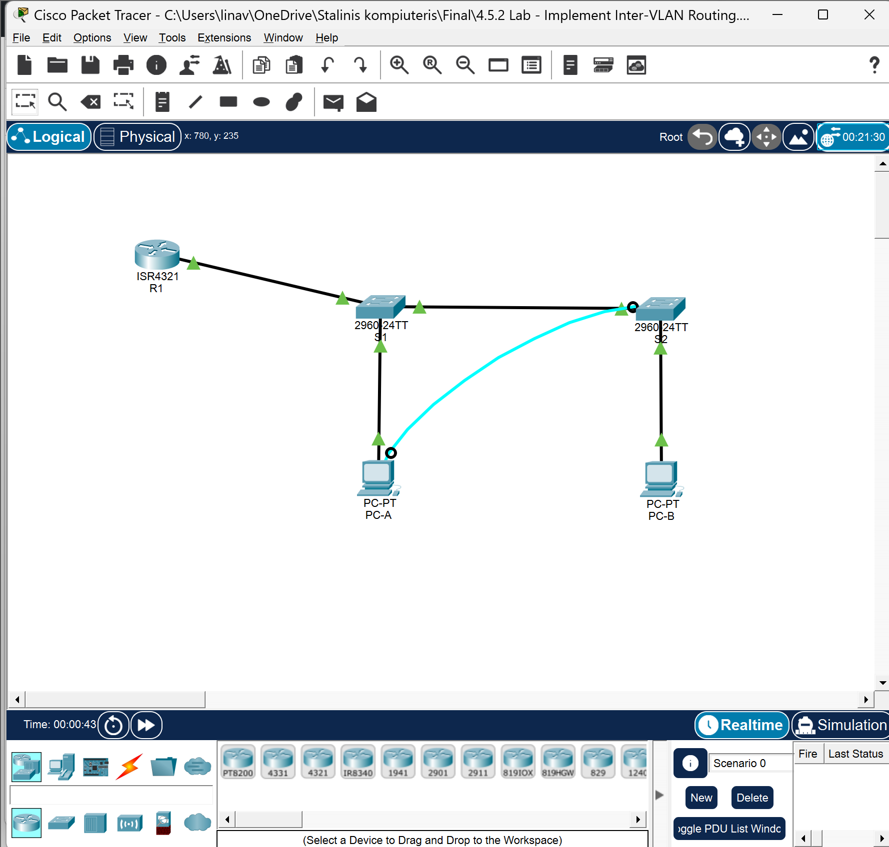

# Cisco CCNA: Switching, Routing, and Wireless Essentials (SRWE)

This repository showcases practical networking work completed as part of the Cisco CCNA Switching, Routing, and Wireless Essentials (SRWE) project at Atlantic Technological University.

The project was completed using Cisco Packet Tracer and included hands-on configuration, implementation, verification, and troubleshooting of switched, routed, secured, and wireless networks.

## Example Network Topology

The topology below is from the completed Inter-VLAN Routing lab.

## Featured Labs

The following Cisco Packet Tracer labs demonstrate practical experience in configuring, securing, and troubleshooting computer networks.

| Lab | Description |
|-----|-------------|
| [Inter-VLAN Routing](4.5.2%20Lab%20-%20Implement%20Inter-VLAN%20Routing.pkt) | Configuring VLANs, trunk links, and inter-VLAN communication using router-on-a-stick. |
| [EtherChannel](6.2.4-packet-tracer---configure-etherchannel.pka) | Configuring link aggregation between Cisco switches. |
| [DHCPv4](7.4.2%20Lab%20-%20Implement%20DHCPv4.pkt) | Configuring DHCP services for automatic IPv4 address allocation. |
| [DHCPv6](8.5.1%20Lab%20-%20Configure%20DHCPv6.pkt) | Configuring IPv6 address allocation and DHCPv6 services. |
| [Wireless LAN Controller](13.2.7-packet-tracer---configure-a-basic-wlan-on-the-wlc.pka) | Configuring wireless networks using a Cisco WLC. |
| [Switch Security](11.6.1-packet-tracer---switch-security-configuration.pka) | Implementing security features on Cisco switches. |

All labs were completed using Cisco Packet Tracer as part of the CCNA Switching, Routing, and Wireless Essentials (SRWE) project.

## Skills and Technologies

- Cisco Packet Tracer
- Cisco IOS
- VLANs and VLAN Trunking
- Inter-VLAN Routing
- Router-on-a-Stick
- Spanning Tree Protocol (STP)
- EtherChannel
- DHCPv4 and DHCPv6
- IPv4 and IPv6
- Static and Default Routing
- HSRP
- Port Security
- Switch Security
- SSH
- Wireless LANs (WLAN)
- Wireless LAN Controller (WLC)
- WPA2 Enterprise
- Network Troubleshooting

## Practical Work

During the project, I completed a range of Packet Tracer labs involving:

- Configuring Cisco switches and routers
- Configuring VLANs, trunks, and inter-VLAN routing
- Implementing and troubleshooting EtherChannel
- Configuring DHCPv4 and DHCPv6
- Configuring IPv4 and IPv6 static and default routes
- Implementing port and switch security
- Configuring wireless networks and WLANs using a WLC
- Troubleshooting routing, VLAN, EtherChannel, and wireless connectivity issues
- Testing and verifying network connectivity using Cisco IOS commands

## Tools

- Cisco Packet Tracer
- Cisco IOS CLI

## Project Period

June 2026 – August 2026

## Verification and Testing

The following Cisco IOS commands can be used to verify network configurations and troubleshoot connectivity issues.

| Command | Purpose |
|---------|---------|
| `show vlan brief` | Verify VLANs and assigned switch ports. |
| `show interfaces trunk` | Check trunk connections and allowed VLANs. |
| `show etherchannel summary` | Verify EtherChannel status and member interfaces. |
| `show spanning-tree` | Check STP status and root bridge information. |
| `show ip interface brief` | Verify interface IP addresses and status. |
| `show ip route` | Check the IPv4 routing table. |
| `show ipv6 route` | Check the IPv6 routing table. |
| `show ip dhcp binding` | Check DHCPv4 address assignments on a Cisco DHCP server. |
| `show port-security` | Verify switch port security status. |
| `ping` | Test connectivity between network devices. |

These commands help verify switching, routing, network security, and connectivity across the completed Packet Tracer labs.

## About

This repository is part of my technical portfolio and demonstrates practical experience gained while completing the Cisco CCNA SRWE networking project.
